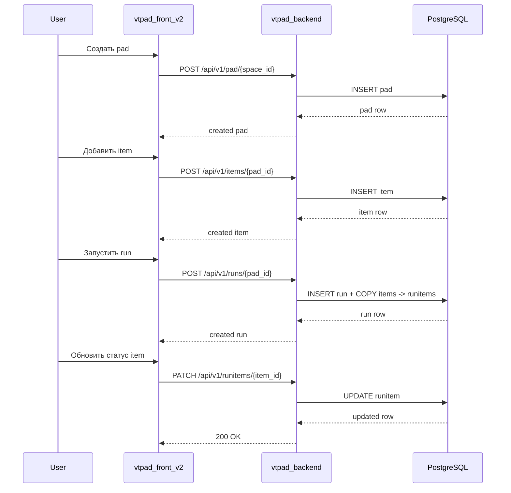
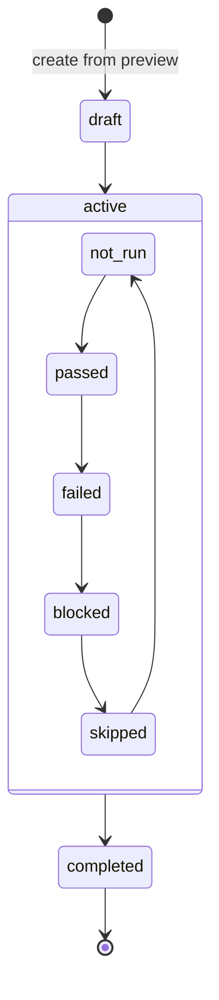

# Жизненный цикл Pad / Run

## Что описывает

Поток создания тест-плана (Pad), его наполнения items, запуска прогона (Run) и фиксации результатов.

## Preconditions

- Пользователь аутентифицирован и имеет доступ к space.
- Space существует.

## Поведение системы

### Создание Pad

1. Пользователь создаёт pad в UI.
2. Frontend: `POST /api/v1/pad/{space_id}` с `CreatePadDto`.
3. Backend создаёт pad в PostgreSQL.

### Наполнение Pad items

1. Frontend: `POST /api/v1/items/{pad_id}` с `CreateItemDto`.
2. Backend создаёт item (может ссылаться на testcase или checklist).
3. Frontend: `PUT /api/v1/testcases-paditem/...` для привязки testcase (deprecated).

### Создание Run

1. Пользователь запускает run из pad.
2. Frontend: `POST /api/v1/runs/{pad_id}` с `CreateRunDto`.
3. Backend:
   - Создаёт run.
   - Копирует items из pad в runitems.
4. Возвращает run с runitems.

### Прохождение Run

1. Пользователь обновляет статус runitem.
2. Frontend: `PATCH /api/v1/runitems/{item_id}` с `UpdateRunItemDto`.
3. Backend обновляет статус (pass / fail / skip и т.д.).

### Sequence diagram

## Edge-cases

| Сценарий | Где проявляется | Поведение системы |
|---|---|---|
| Pad не найден | `POST /runs/{pad_id}` | `404` |
| Run не найден | `PATCH /runitems/{item_id}` | `404` |
| Нет прав на space | space-level endpoints | `403` |

## Ограничения

- Нет встроенного механизма версионирования pad (snapshot перед изменением).
- Run копирует items на момент создания; изменения pad после этого не отражаются на run.

## V2 Test Run lifecycle

V2 test run — отдельный, современный поток для выполнения test cases; он не изменяет legacy Pad / Run выше.

1. Создатель выбирает ровно один источник: test suite, test plan или хотя бы один testcase.
2. `POST /api/v2/test-run/preview` возвращает точный состав и `source_hash`.
3. `POST /api/v2/test-run` с этим hash повторно валидирует состав и атомарно создаёт run вместе с результатами и snapshots cases.
4. В active run исполнитель может исправлять результат: круглый индикатор циклично переключает `not_run → passed → failed → blocked → skipped → not_run`, а диалог редактирования доступен для любого результата. Возврат в `not_run` очищает исполнителя и время выполнения; bulk-action допускает тот же статусный набор.
5. У run есть атрибуты milestone и environment. Фильтрация списка поддерживается API.
6. После завершения run его результаты неизменяемы. Устаревшие записи без snapshot показываются как legacy, без заявления об исторической точности.
7. Успешный переход active → completed в той же транзакции закрывает timer interval и создаёт не более одного `RUN_COMPLETED` уведомления создателю run. Если создатель отсутствует, уведомление не создаётся. Его payload содержит только UUID run и route `/space/{space_id}/test-runs/{run_id}`. Повторная попытка защищена уникальностью `(run_id, event, user_id)`.
8. REST и MCP используют общие list/count сервисы уведомлений. Run-событие показывается только пока пользователь остаётся активным участником space или активным company admin той же компании; SSE и отметка прочтения повторно фильтруют доступ. Открытие route повторно проходит обычную проверку доступа к run.

Run detail группирует результаты по suite и полному пути секций. На desktop навигатор групп sticky слева и прокручивается независимо от результатов; на узком экране он становится компактной горизонтальной навигацией. Навигатор подсвечивает группу, которая сейчас находится в области просмотра, а выбор группы переводит фокус на её заголовок. Полные названия suite и вложенных секций доступны скринридеру, даже когда видимая подпись сокращена. Сводка сначала показывает прогресс и статусы, затем объединённые замеры времени кейсов и общий таймер run. Неизвестная длительность отображается как отсутствие данных, ноль остаётся измеренным значением. Состояние таймера и календарное/активное/паузное время вычисляются по сохранённым отметкам времени и обновляются при загрузке или ручном обновлении; фоновый цикл не используется. Переход из аналитики дефектов открывает нужный результат в run detail.

В сводке общего таймера календарное прошедшее время отделено от измеренных активного и паузного интервалов. Для запусков до появления трекинга календарное время рассчитывается по отметкам запуска и завершения/текущему времени, а активное и паузное время показываются как недоступные. Такое календарное значение не является оценкой времени работы тестировщика.

Для checklist run detail открывает checks из сохранённого snapshot и показывает тип `checklist`. На уровне run сохраняется один статус всего checklist; отдельного статуса для каждой строки нет. Результаты со старых запусков без snapshot остаются legacy и отображают доступные данные текущего testcase.

Completed runs can be compared within one space through REST `GET /api/v2/test-run/{run_id}/compare/{other_run_id}` and MCP `compare_test_runs`. The projection matches cases by snapshot `testcase_id`, reports added/removed cases, snapshot field changes, and separate status/comment/duration changes. It never reads the current testcase to fill a missing historical snapshot; missing or incomplete fields are reported as unknown. Rich-text fields are normalized through the editor's safe-markup allowlist for comparison and sanitized again before display. Draft or active runs return `422`; a run from another space is hidden as `404`. Different suite/plan/selected-case sources are labeled in the comparison summary.

### Public run links

An authorized active member can create or revoke a public link for a run. Creation is limited to the run creator or active space owner; an active company admin also needs active membership in that space. A single active link is rotated on reissue and expires after seven days. The token is shown once and stored only as a versioned HMAC digest. Redemption is available through REST and authenticated MCP and returns only the run name/status plus group names, case counts, status counts, and known duration totals. It does not include testcase content, comments, bugs, files, or user names. The REST view accepts the token only in the `Authorization` header; the Vue page reads it from the URL fragment, removes the fragment before network access, and sends no referrer. Its public route waits for initial route metadata before mounting route content, skips authentication redirection, and does not mount the authenticated Spaces navigation or command palette. `PUBLIC_RUN_LINKS_ENABLED` is off by default until independent security acceptance.

### Bug links on run results

Результат сохраняет `linked_bug_ids` как legacy JSON без нормализации или миграции. В ответах совместимое поле `linked_bug_ids` остаётся массивом, а `linked_bug_ids_raw` возвращает исходное JSON значение. Новые связи лежат отдельно в `test_result_bug_link` и используют `bugsmodel.link_uuid`. REST и MCP проверяют membership пользователя в space, активность run и принадлежность bug тому же space. Legacy операции по short name применяются только при единственном совпадении; иначе клиент получает `409` и должен использовать UUID. Quick create создаёт bug, связь и глобальную квитанцию `operation_id` в одной транзакции; повтор с теми же actor/result/body возвращает тот же bug, а несовпадающий повтор не раскрывает его.

Миграция v14 только добавляет таблицы и индексы, выполняется транзакционно и записывает ledger в той же транзакции. Перед применением на целевой БД нужен проверенный backup. При ошибке транзакция откатывает и DDL, и ledger, поэтому исправленную миграцию можно повторить. После успешного запуска откат выполняется возвратом предыдущей версии приложения с сохранением новых таблиц; их нельзя удалять после начала записи. Если bug из quick-create удалён, receipt остаётся как tombstone, а тот же `operation_id` получает `410` вместо повторного создания.

## Источники в коде

- `vtpad_backend/app/src/pad/router.py`
- `vtpad_backend/app/src/pad/service.py`
- `vtpad_backend/app/src/items/router.py`
- `vtpad_backend/app/src/run/router.py`
- `vtpad_backend/app/src/run/service.py`
- `vtpad_backend/app/src/runitems/router.py`
- `vtpad_front_v2/src/components/pads/padsListComponent.vue`
- `vtpad_front_v2/src/components/runs/detail/runsDetailComponent.vue`
- `vtpad_backend/app/src/test_run/router.py`
- `vtpad_backend/app/src/test_run/service.py`
- `vtpad_front_v2/src/components/test-runs/testRunsListComponent.vue`
- `vtpad_front_v2/src/components/test-runs/detail/testRunDetailComponent.vue`
